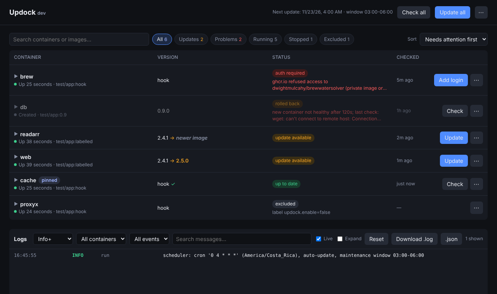

<h1>
  <picture>
    <source media="(prefers-color-scheme: dark)" srcset="docs/brand/logo-dark.svg">
    
  </picture>
</h1>

[](https://github.com/dwightmulcahy/updock/actions/workflows/ci.yml)
[](https://github.com/dwightmulcahy/updock/actions/workflows/release.yml)
[](https://github.com/dwightmulcahy/updock/releases/latest)
[](.github/dependabot.yml)
[](LICENSE)

Watchtower-style auto-updater for Docker containers, with a web UI to check, update or recreate any container on demand.



## Features

- **Safe updates**: digest checks without pulling, health-checked recreates, automatic rollback,
  Compose-aware ordering and `depends_on` restarts ([how it works](docs/how-it-works.md)).
- **Control what moves**: semver tag following, approval for bigger version steps, image cooldown,
  pin / monitor-only / protected containers, maintenance windows ([configuration](docs/configuration.md)).
- **Web UI**: live progress, per-container versions, release-note links, logs and a health tab ([UI](docs/ui.md)).
- **Lifecycle hooks, health monitor and self-update** ([how it works](docs/how-it-works.md)).
- **Email notifications**, Prometheus metrics and a dashboard summary API
  ([notifications](docs/notifications.md), [API](docs/api.md)).
- **Hardened**: read-only root filesystem, socket-proxy support, file-based secrets, cosign signature checks
  ([security](docs/security.md)).

## Quick start

```bash
cp .env.example .env
./scripts/init-secrets.sh     # random UI password + API token in ./secrets (prints the login)
docker compose up -d --build
curl http://localhost:8080/health
# UI: http://localhost:8080
```

Published image: `ghcr.io/dwightmulcahy/updock`, for `linux/amd64`, `linux/arm64` and `linux/arm/v7` (32-bit Raspberry Pi OS, older ARM NAS boxes).

QNAP: `docker compose -f compose.qnap.yaml pull && docker compose -f compose.qnap.yaml up -d`

Both Compose files run with a read-only root filesystem, all capabilities
dropped, `no-new-privileges`, bounded memory/PIDs, an init process, a graceful
shutdown window, and rotated JSON logs. The process runs as root inside the
container only so it can reach the mounted Docker socket.

> [!WARNING]
> Access to the Docker socket is equivalent to root on the host. Always set
> `UPDOCK_PASSWORD` and don't expose port 8080 publicly.

For a [socket proxy](docs/socket-proxy.md) in front of the Docker socket, see [security](docs/security.md).

## Documentation

| Topic | |
|---|---|
| [How it works](docs/how-it-works.md) | Update flow, rollback, Compose, hooks, health monitor, self-update, cooldown, versions, semver, approvals |
| [Configuration](docs/configuration.md) | Every `UPDOCK_*` variable, choosing containers, private registries |
| [The UI](docs/ui.md) | Containers table, tabs, logs |
| [API and monitoring](docs/api.md) | Endpoints, API token, SSE, Prometheus, dashboard summary |
| [Email notifications](docs/notifications.md) | SMTP settings and events |
| [Security](docs/security.md) | Socket proxy, browser protection, secrets, reverse-proxy sign-in, cosign |
| [Socket proxy guide](docs/socket-proxy.md) | Step-by-step setup and troubleshooting |
| [Development](docs/development.md) | Tests, dependency locks, releasing |

## License

[MIT](LICENSE)
