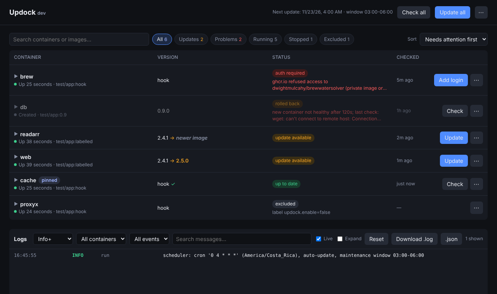

# The UI

- One row per container: name, state and image; **version** shows running → newer (`2.4.1 → 2.5.0`, ✓ when current; tag or build date when the image has no version label); **status** with the reason when something needs attention.
- The button does the next useful thing: **Update** when a newer image exists, **Add login** when a registry refused access, otherwise **Check**. Everything else (update now, recreate, versions, pin, logs, release notes) is in the **⋯** menu.
- Click a row for full details: running and latest image (ID, digest, revision, build date, release notes), last check/update, why it's excluded or pinned, and the full message.
- **Check all** / **Update all** show a progress banner (`Checking containers 3 of 12 · bazarr · 0:14`) with the remaining containers marked **queued**, then a summary (`Check finished in 14s · 12 containers: 2 update available, 10 up to date`) with a shortcut to the problems or updates. Only one run at a time.
- An update shows its steps live — Pull (with download %), Stop, Start, Health check (with time left), Clean up — and how long it has been running.
- Tick the boxes in front of rows (or the header box for every row shown) to **Check selected** / **Update selected**: the same rules as **Update all** (dependencies first, cooldown, pinned / monitor-only / protected containers only checked), shown in the same progress banner. API: `POST /api/selected/check` or `/update` with `{"names": ["web", "db"]}`.
- Search by name or image, filter (**Updates**, **Problems**, **Running**, **Stopped**, **Excluded**, with counts) and sort (needs attention first, name, last checked, recently updated); the choice is remembered. Narrow screens drop the "checked" column.

The header has these tabs: **Containers** (the table), **Logs** (filterable live log, newest first, full height), **Health** (only with the [health monitor](how-it-works.md#health-monitor) on) and **About** (version, Docker engine, the settings in effect, and [self-update](how-it-works.md#self-update) when enabled; `GET /api/about`). The tab is kept in the URL (`#logs`, `#health`, `#about`).

After Updock itself is upgraded, the UI shows **What's new since vX** once per browser: the features, fixes and breaking changes of every release in between, with links to the PRs (also under **⋯ → What's new…**). The notes are bundled into the image at release time (`scripts/build_changelog.py` → `app/changelog.json`, `GET /api/changelog?since=0.5.0`), so no internet access is needed; development builds have none.

The UI follows the system light/dark setting; **⋯ → Theme** switches between auto, light and dark (remembered per browser). On phones the table turns into stacked cards.

**Group by project** (toolbar) groups containers by Compose project. Each project has **Check** and **Update** buttons that run just that project, dependencies first (`depends_on`), with the same rules as **Update all** (cooldown, pinned/monitor-only, health checks). API: `POST /api/projects/{project}/check` or `/update`.

## Logging

Every action is logged with its level, container and event type (`check`, `pull`, `update`, `recreate`, `deploy`, `rollback`, `cleanup`, `run`, `error`, …). The **Logs** panel in the UI filters by minimum level, container, event and free text (with highlighting), can pause live updates, expands to full height, and downloads the current view as `.log` or `.json`. Each container row has a **Logs** button that filters to it. Unexpected errors include a collapsible traceback.

The same entries go to stdout (`docker logs updock`) as text or JSON lines.
